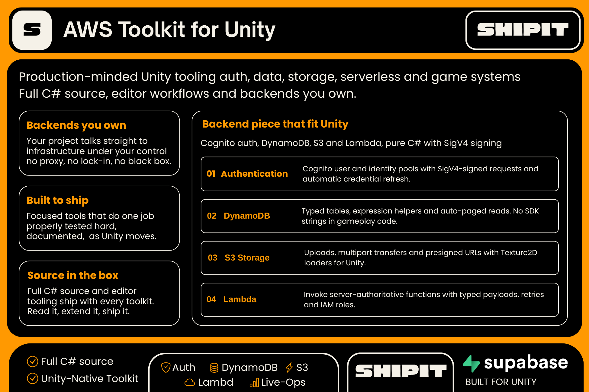
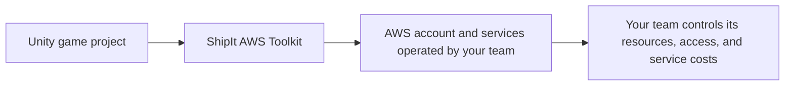

# ShipIt AWS Toolkit

> Public product reference. This repository contains documentation only; it does not contain the toolkit source code or package files.

**Website:** [shipitunity.com](https://shipitunity.com)  
**Asset Store:** [ShipIt publisher page](https://assetstore.unity.com/publishers/150952)  
**More from ShipIt:** [DEV](https://dev.to/shipitunity) · [Hashnode](https://hashnode.com/@shipitunity) · [X](https://x.com/shipitunity) · [GitHub](https://github.com/ShipIt-Unity)

The ShipIt AWS Toolkit helps Unity teams connect their games to AWS services they operate. See the [product overview](FEATURES.md) and [version-history record](CHANGELOG.md).

## Product overview

### How it fits

At a high level, the toolkit helps bring selected cloud capabilities and common player workflows into Unity projects. See the linked overview for the product-level feature summary; this page does not include a service matrix or implementation steps.

This page does not state a current package version or availability. Check the current website and publisher page before purchase.

## Important boundary

This is not a source-code repository or a hosted AWS service. Your team owns its AWS account, configuration, permissions, and service charges. Follow the product documentation for credentials, IAM, and platform-specific setup.

## Feedback

Public issue intake and a community invite are not enabled here yet. Do not post secrets, private project files, or security vulnerabilities in public.
